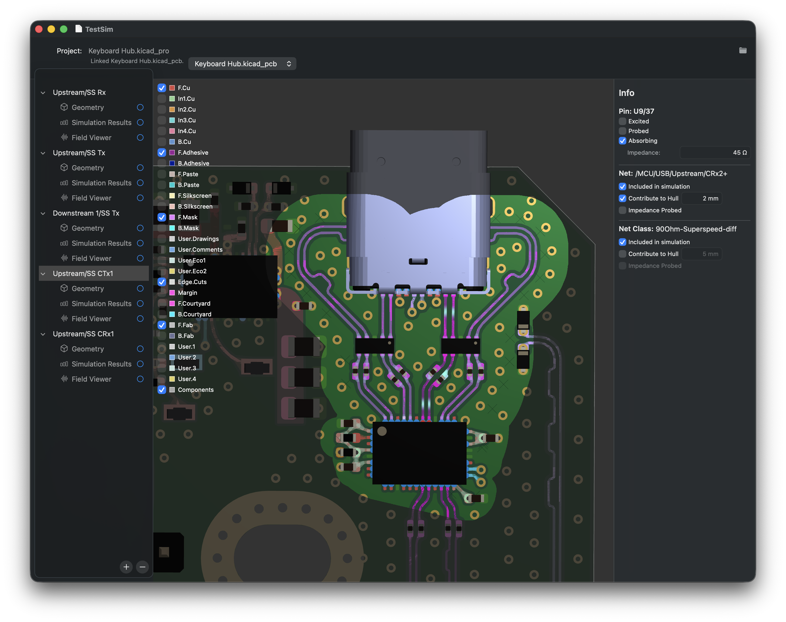
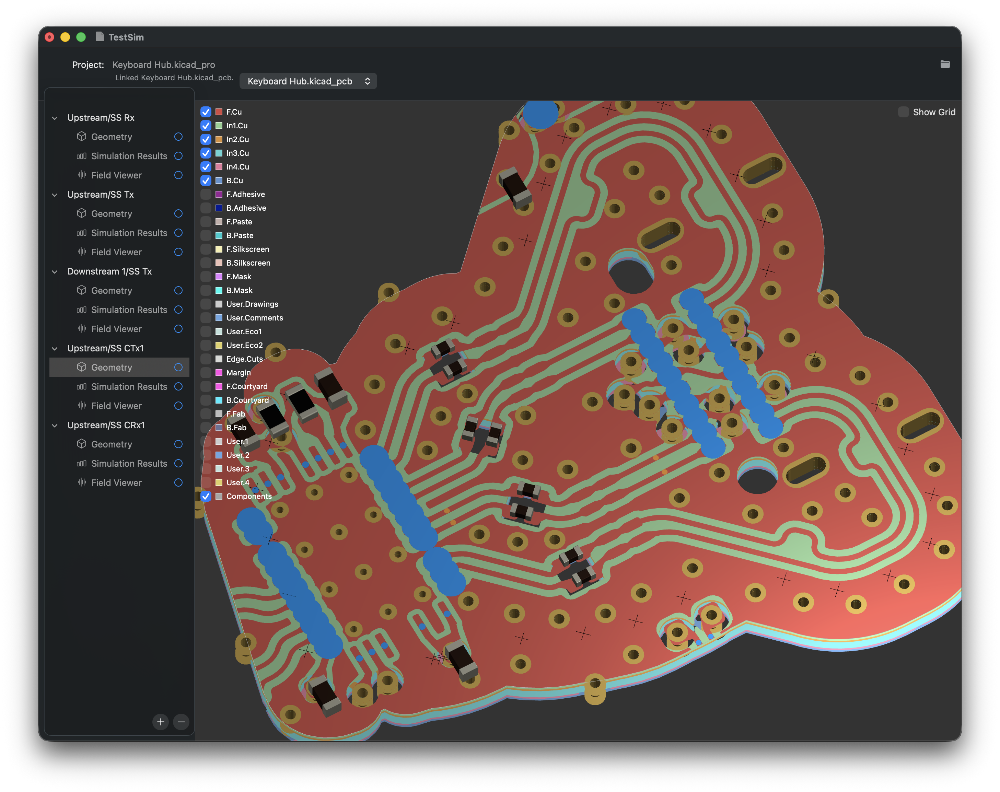
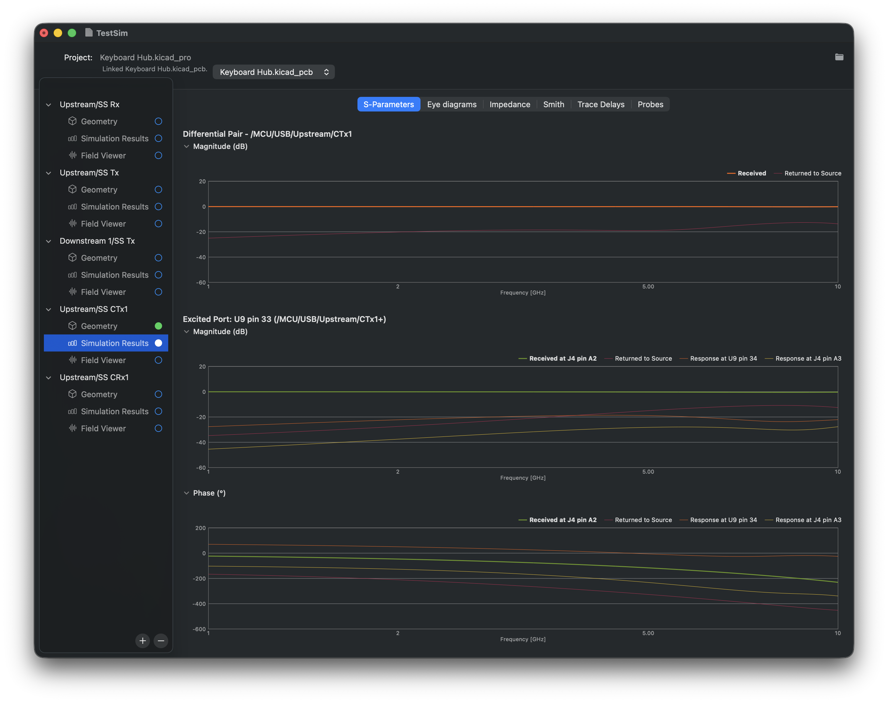
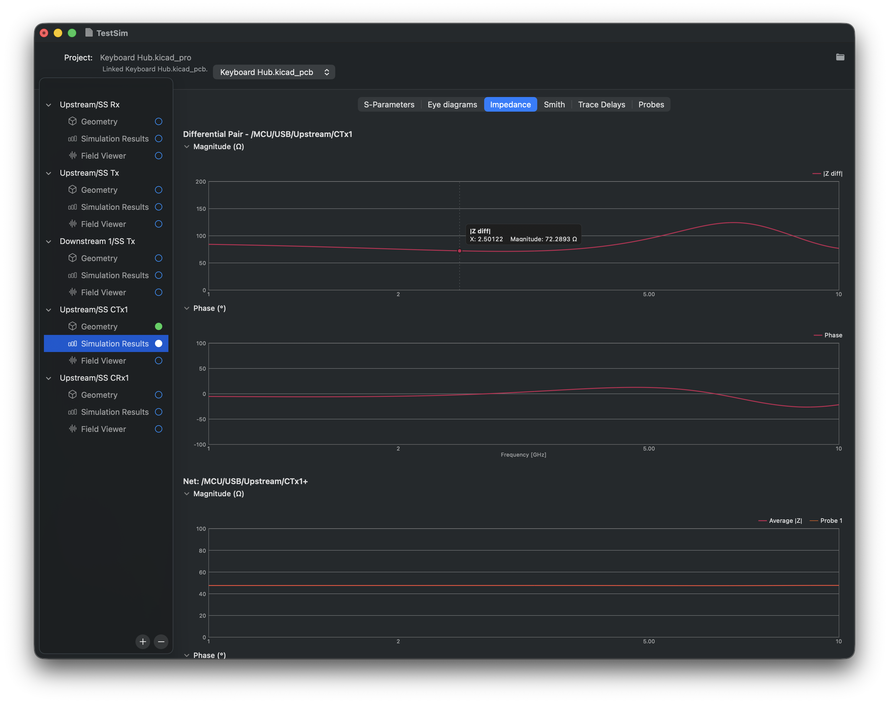
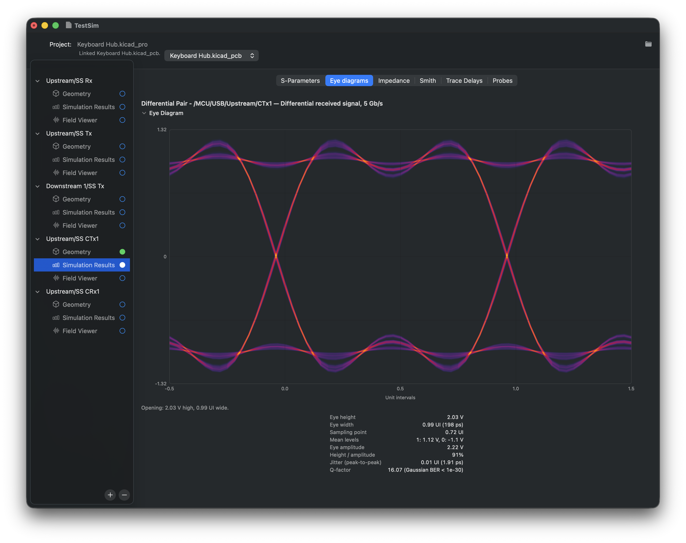
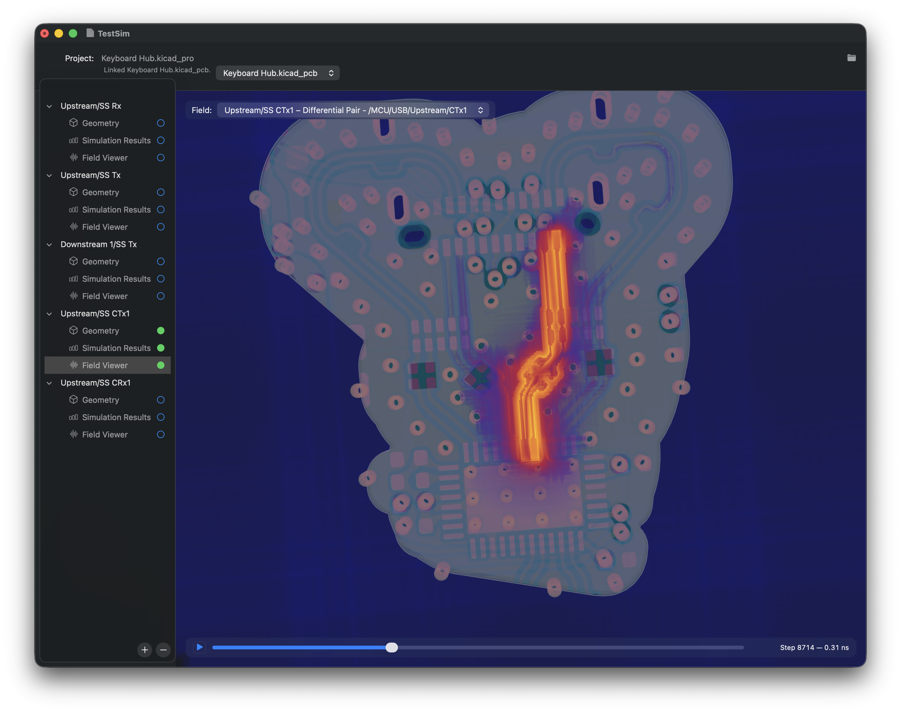

# KiEMS

KiEMS is an electromagnetic simulation tool for KiCad PCB designs. It turns a
board and simulation configuration into geometry, runs an FDTD simulation, and
produces results such as S-parameters, impedance, delay, Smith charts, probe
plots, and eye diagrams.

The repository contains three main pieces:

- **KiEMS.app** — the native desktop application for configuring, running, and
  inspecting simulations. It is **macOS-only**.
- **`kiems`** — a cross-platform command-line interface for the same workflow.
- **`libkiems`** — the cross-platform C++ simulation library used by both
  interfaces.

## KiEMS application

### Configure the board and simulations

Select the relevant layers, nets, ports, and simulation settings directly on a
rendered KiCad board.



### Inspect generated geometry

Review the derived board geometry, copper, components, and port locations
before running a simulation.



### Explore results

Browse the simulated electrical behaviour through S-parameters, impedance,
Smith charts, trace delays, probes, and eye diagrams.







### Visualize fields over time

The field viewer overlays the evolving electromagnetic field on the board and
provides timeline controls for inspecting the simulation.



### Produce reports

<!-- TODO: describe PDF results reports and add an example page image. -->


## kiems command line tool

The command-line product is named `kiems`. Its default configuration is
`./simulation.json`, and paths relative to that file are resolved from the
configuration file's directory.

```sh
kiems --help
```

A typical full run imports a KiCad board and performs every stage:

```sh
kiems --input path/to/board.kicad_pcb --all
```

Useful stage flags are:

| Flag | Action |
| --- | --- |
| `--geometry` / `-g` | Create simulation geometry |
| `--simulate` / `-s` | Run the FDTD simulation |
| `--postprocess` / `-p` | Create result data and plots |
| `--all` / `-a` | Run all three stages |

By default, simulations use the openEMS CPU backend. Where the bundled Copper
backend is available, `--backend gpu` selects it. See `kiems --help` for
configuration updates, input/output overrides, field export, plotting options,
and diagnostics.

For a configuration stored at `path/to/simulation.json`, KiEMS writes its
working data relative to that file:

```text
path/to/
├── fab/                 # persisted KiCad board and project copies
└── ems/
    ├── geometry/
    ├── simulation/
    └── results/
```

Each configured simulation is kept in its own subdirectory, so multiple runs
do not overwrite one another.

## libkiems

`libkiems` is the C++ library that both the app and the command-line tool are
built on. See the [libkiems documentation](docs/libkiems.md) for its API.

## Building

### Getting the source

The source is hosted at <https://github.com/beelsebob/KiEMS>. KiEMS depends on
the Copper, libkicad, and RememberRemember submodules, so clone recursively:

```sh
git clone --recurse-submodules https://github.com/beelsebob/KiEMS.git
cd KiEMS
```

For an existing clone, fetch the submodules with:

```sh
git submodule update --init --recursive
```

### Dependencies

The dependency checker installs or verifies everything KiEMS and its submodules
need.

```sh
Scripts/check_dependencies.py
```

It checks out the submodules, checks each component's packages (Homebrew on
macOS; APT, DNF, Pacman, or Zypper on Linux), prints the command that installs
anything missing, then sets up and validates the build:

| Option | Effect |
| --- | --- |
| `--component NAME` | Check only `build`, `kiems`, `copper`, or `libkicad` (repeatable) |
| `--install` | Install missing packages, after asking |
| `--yes` | Don't ask before installing; requires `--install` |
| `--no-configure` | Skip the setup and validation steps |
| `--ssh` | macOS only: fetch GitHub submodules over ssh |

On Linux the setup builds the pinned KiCad libraries needed by `libkicad` when
they are missing or stale, and validates the result by configuring CMake. Nix
users can use `nix develop` instead.

If you would rather install dependencies yourself, you need:

- **Build tools:** a C++ compiler, CMake, Ninja, pkg-config, and Git (on macOS,
  Xcode and its command-line tools, plus Homebrew)
- **KiEMS:** GEOS 3.10 or newer, Matplot++, gnuplot, and nlohmann-json
- **Copper and CSXCAD:** HDF5, Blosc2, CGAL, Boost, GMP, MPFR, and VTK
- **libkicad:** a source build of KiCad matching the pinned version, with its
  dependencies (wxWidgets, GTK 3, GLM, Cairo, Pixman, FreeType, HarfBuzz,
  OpenCASCADE, ngspice, libspnav, libgit2, NNG, zstd, Protobuf, Fontconfig,
  GLU, and unixODBC)

Per-distribution package names are listed in
[`Dependencies/linux-packages.json`](Dependencies/linux-packages.json).

### Building

#### macOS

Open `kiems.xcodeproj` in Xcode and select one of these schemes:

- **KiEMS** to build and run the desktop app;
- **kiems CLI** to build the command-line executable; or
- **libkiems_tests** to run the library test suite.

To run the tests without opening Xcode:

```sh
Scripts/run_libkiems_tests.sh
```

The command-line tools can also be built with CMake:

```sh
cmake --preset macos-release
cmake --build --preset macos-release --target kiems-cli kiems_fdtd_worker copper_fdtd_worker
```

#### Linux

Once the dependencies are installed, configure and build with CMake:

```sh
cmake --preset linux-release
cmake --build --preset linux-release --target kiems-cli kiems_fdtd_worker copper_fdtd_worker
```

`libkiems_tests` uses Apple's XCTest framework, so the test suite only runs on
macOS.
